# Báo cáo giữa kỳ — Lập trình Web nâng cao

**Đề tài:** Ứng dụng quản lý mượn sách thư viện
**MSSV:** B23DCCC149

**Công nghệ:** React 19 · TypeScript · Vite · Tailwind CSS v4 · Redux Toolkit · Zustand · React Router · lucide-react · Jest + React Testing Library

---

## 1. Cách chạy dự án

Yêu cầu: Node.js ≥ 20.

```bash
npm install        # cài thư viện
npm run dev        # chạy dev → http://localhost:5173
npm test           # chạy toàn bộ test (Jest)
npm run build      # kiểm tra kiểu TypeScript + build production
npm run preview    # chạy bản build production
```

Giả lập API lỗi: mở `http://localhost:5173/?fail`.

**Cách lấy kết quả trong báo cáo** (không có số liệu nào viết tay):

- **Ảnh giao diện và số liệu ở mục 3:** chụp tự động bằng Google Chrome (điều khiển qua `puppeteer-core`) trên bản build production (`npm run preview`). Chrome thao tác như người dùng thật: gõ tìm kiếm, bấm lọc, bấm Mượn/Trả, đổi theme, chuyển trang. Các con số (số thẻ sách, số bản còn lại, thời gian tải, file JS được tải) được đọc trực tiếp từ trang. Việc kiểm tra file được tải khi vào `/stats` tương đương xem tab Network khi bật F12. Màn hình desktop có độ rộng 1920px, điện thoại 390px.
- **Ảnh kết quả test ở mục 5:** chạy thật lệnh `npm test -- --verbose --reporters=default`, giữ nguyên văn output của Jest.

Toàn bộ ảnh nằm trong [docs/images/](docs/images/).

---

## 2. Cấu trúc thư mục (feature-based)

```
src/
  api/booksApi.ts                API giả lập: Promise + setTimeout 500ms, tham số shouldFail
  types/api.ts                   ApiResult<T> + type guard isApiSuccess
  types/book.ts                  Book, Category, các utility type
  types/notice.ts                kiểu thông báo cho toast
  app/store.ts                   configureStore + đăng ký middleware
  app/hooks.ts                   typed hooks useAppSelector / useAppDispatch
  components/                    Header, HomeBanner, Toaster, BookCover (ảnh lazy), LoadingState, ui.ts
  features/
    books/
      booksSlice.ts              createSlice + createAsyncThunk + selectors
      borrowLimitMiddleware.ts   middleware tự viết: tối đa 3 cuốn
      BookItem.tsx               1 cuốn sách (React.memo)
      BookList.tsx               lọc (useMemo + useDebounce), handler useCallback
      BorrowedPanel.tsx          khung "Sách đang mượn" bên trái
      BooksGate.tsx              trạng thái "Đang tải..." / lỗi
    filters/useFilterStore.ts    Zustand: từ khoá, thể loại
    filters/FilterBar.tsx        ô tìm kiếm + nút lọc thể loại
    theme/ThemeContext.tsx       Context sáng/tối + useTheme
    stats/StatsPage.tsx          trang /stats (lazy load)
  hooks/useDebounce.ts           custom hook generic useDebounce<T>
  pages/HomePage.tsx
```

---

## 3. Kết quả các yêu cầu chức năng

### 3.1. Tải dữ liệu từ API giả lập, hiển thị "Đang tải..."

API trễ 500ms. Kết quả đo: chữ "Đang tải..." hiện ngay, sau **~630ms** danh sách xuất hiện (500ms API + thời gian render).

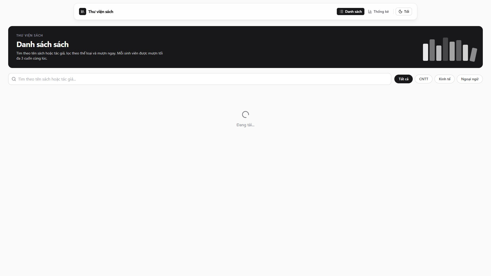

### 3.2. Hiển thị danh sách sách

Mỗi thẻ được thiết kế giống một cuốn sách: rìa trái là **gáy sách dày 16px, đậm nhạt theo thể loại** (CNTT đen · Kinh tế xám đậm · Ngoại ngữ xám nhạt, hợp tông trắng đen của app), có nếp gấp như bìa thật. Thẻ hiển thị: ảnh bìa, **tên sách, tác giả, thể loại** (CNTT / Kinh tế / Ngoại ngữ), **năm xuất bản** và **số bản còn lại**. Kết quả: hiển thị đủ **24 cuốn**.


### 3.3. Tìm kiếm theo tên hoặc tác giả, debounce 300ms

Gõ `MANKIW` (chữ hoa) để kiểm tra việc không phân biệt hoa thường:

| Thời điểm sau khi gõ | Số sách hiển thị |
|---|---|
| 100ms (chưa đủ 300ms, chưa lọc) | 24 |
| 500ms (đã qua debounce) | **2** (2 cuốn của tác giả N. Gregory Mankiw) |

| Đang gõ (chưa lọc) | Sau 300ms |
|---|---|
|  | 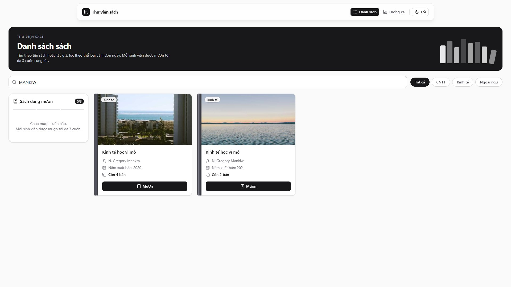 |

### 3.4. Lọc theo thể loại

Bấm **Ngoại ngữ**: còn **8 cuốn**, tất cả đều thuộc thể loại Ngoại ngữ.

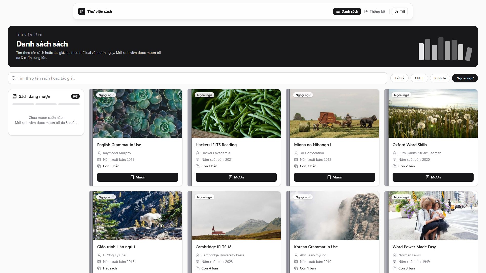

### 3.5. Mượn sách: số bản còn lại giảm 1

Mượn *Clean Code*: số bản còn lại từ **"Còn 3 bản" → "Còn 2 bản"**. Sách vừa mượn hiện trong khung **Sách đang mượn** bên trái (2/3).

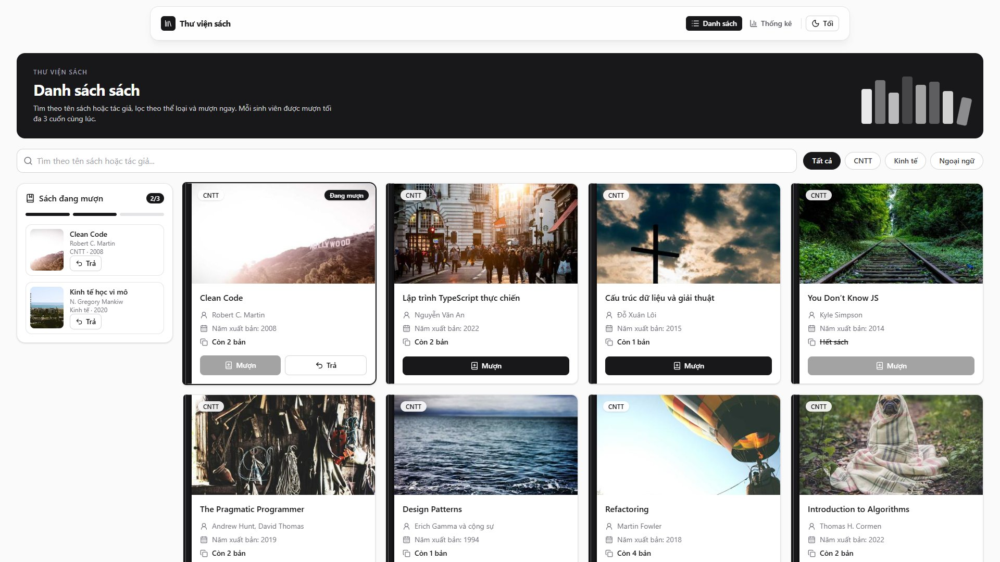

### 3.6. Nút "Mượn" bị vô hiệu hoá khi sách đã hết bản

*You Don't Know JS* có số bản = 0 ("Hết sách") → kiểm tra thấy nút Mượn có `disabled = true`.

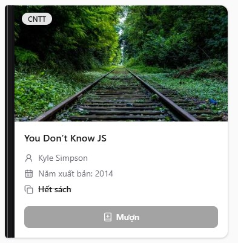

### 3.7. Tối đa 3 cuốn cùng lúc, vượt quá thì chặn và cảnh báo

Mượn thêm cuốn thứ 3 rồi bấm Mượn cuốn thứ 4 (*Refactoring*). Kết quả:
- Số sách đang mượn giữ ở **3/3**.
- *Refactoring* vẫn **"Còn 4 bản"**, tức là lượt mượn đã bị middleware chặn trước khi tới reducer.
- Toast cảnh báo: *"Bạn chỉ được mượn tối đa 3 cuốn cùng lúc. Hãy trả bớt sách trước khi mượn thêm."*

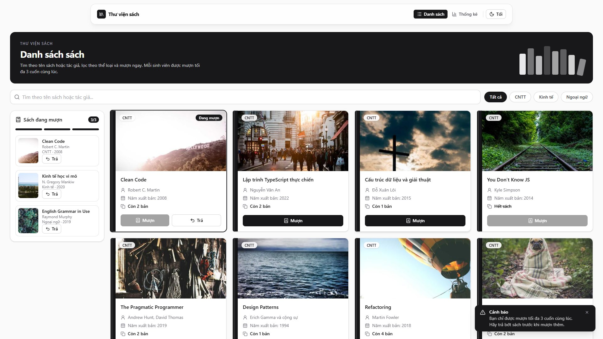

### 3.8. Trả sách: số bản còn lại tăng 1

Cuốn đang mượn hiển thị nút **Trả** (trên thẻ sách và trong khung bên trái). Trả *Clean Code*: **"Còn 2 bản" → "Còn 3 bản"**, số đang mượn còn **2/3**.

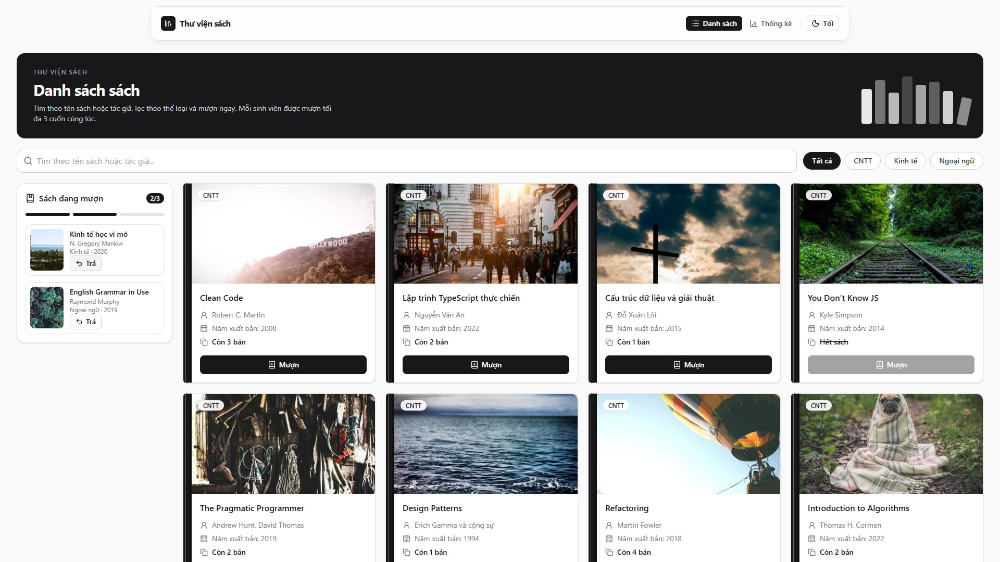

### 3.9. Chuyển giao diện sáng / tối

Bấm nút **Tối** ở góc phải: thuộc tính `data-theme` của trang chuyển thành `dark`.

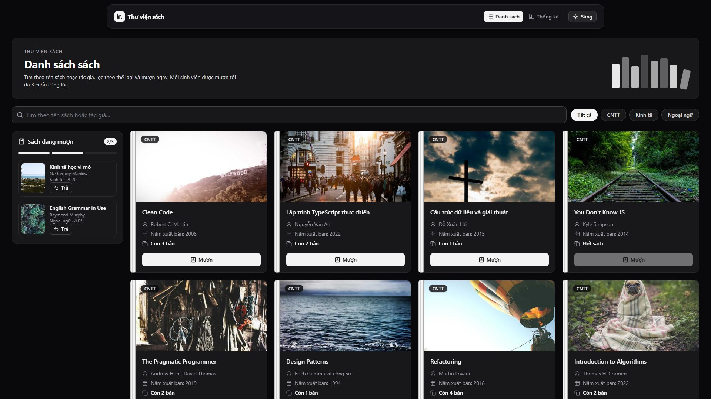

### 3.10. Trang Thống kê (route `/stats`)

Hiển thị **số đầu sách theo từng thể loại** (CNTT 8 · Kinh tế 8 · Ngoại ngữ 8, tổng 24) và **số sách đang mượn** (2/3).

| Sáng | Tối |
|---|---|
| 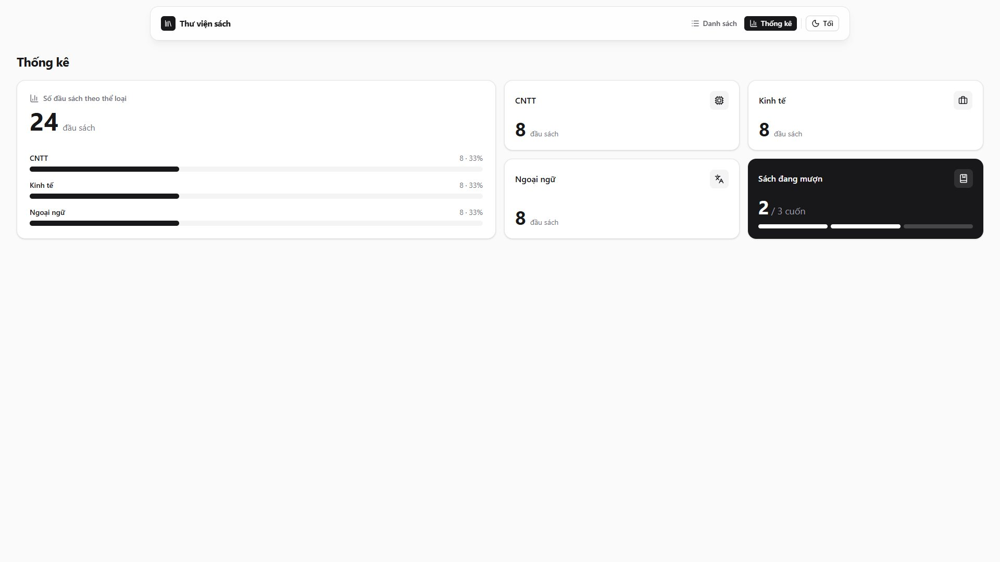 | 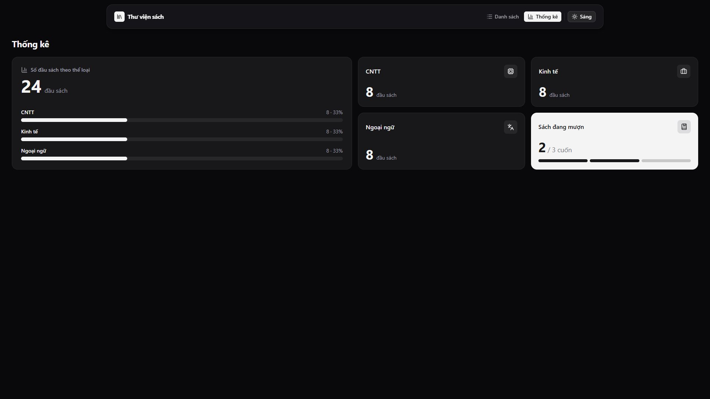 |

### 3.11. Thông báo lỗi khi API thất bại

Mở `/?fail`: hiện khung **"Tải dữ liệu thất bại"** cùng toast lỗi *"Không thể tải danh sách sách. Vui lòng thử lại sau."*

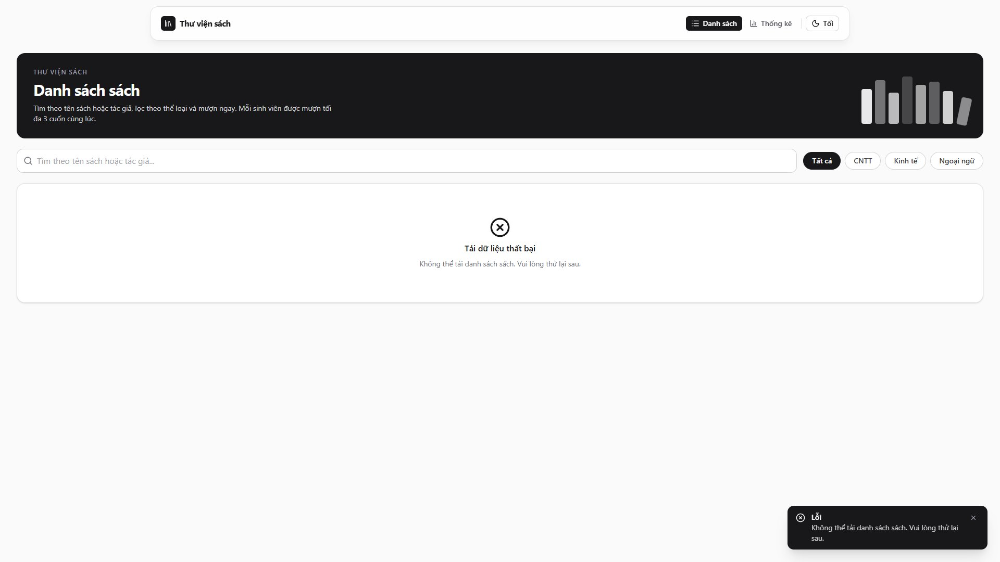

### 3.12. Giao diện điện thoại (390px)

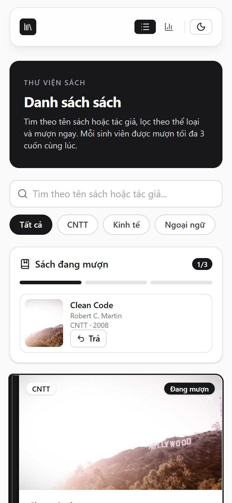

---

## 4. Đáp ứng yêu cầu kỹ thuật

| Yêu cầu | Cách thực hiện | File |
|---|---|---|
| Type đầy đủ, không dùng `any` | Toàn bộ dữ liệu có interface / type; bật `"strict": true` trong `tsconfig.app.json`, kiểm tra bằng `tsc` khi build | `src/types/*` |
| API generic `{ ok: true, data } \| { ok: false, error }` + type guard | `ApiResult<T>` (discriminated union), `isApiSuccess(r): r is ApiSuccess<T>` | `types/api.ts`, `api/booksApi.ts` |
| Ít nhất 2 Utility Type | `Omit<Book, 'id' \| 'coverUrl'>`, `Pick<Book, …>`, `Record<Category, number>`, `Record<Category, string>` (màu gáy sách), `Readonly<Book>`, `Partial<Book>` (test) | `types/book.ts`, `BookItem.tsx` |
| Redux Toolkit: `createSlice`, `createAsyncThunk` đủ 3 trạng thái | `fetchBooks` xử lý `pending / fulfilled / rejected` trong `extraReducers`, lỗi trả về bằng `rejectWithValue` | `features/books/booksSlice.ts` |
| Typed hooks | `useAppDispatch`, `useAppSelector` (`withTypes`) | `app/hooks.ts` |
| Feature-based | `features/books`, `features/filters`, `features/theme`, `features/stats` | `src/features/` |
| Giới hạn 3 cuốn bằng **middleware Redux tự viết** | `borrowLimitMiddleware` chặn action `borrowBook` khi đã mượn 3 cuốn và dispatch cảnh báo (hiển thị bằng toast) | `features/books/borrowLimitMiddleware.ts` |
| Bộ lọc dùng **Zustand** | `useFilterStore` gồm `keyword`, `category` | `features/filters/useFilterStore.ts` |
| Theme dùng **Context**, `useMemo` cho value, hook `useTheme` | `ThemeProvider` + `useMemo(() => ({ theme, toggleTheme }))`, `useTheme` báo lỗi nếu dùng ngoài Provider | `features/theme/ThemeContext.tsx` |
| Custom hook generic `useDebounce<T>` | Dùng cho ô tìm kiếm (300ms) | `hooks/useDebounce.ts` |
| Danh sách sau khi lọc tính bằng `useMemo` | `filteredBooks = useMemo(…, [books, debouncedKeyword, category])` | `features/books/BookList.tsx` |
| Component 1 cuốn sách bọc `React.memo` | `export const BookItem = memo(BookItemBase)` | `features/books/BookItem.tsx` |
| Handler dùng `useCallback`, key không dùng index | `handleBorrow`, `handleReturn` dùng `useCallback`; `key={book.id}` | `features/books/BookList.tsx` |
| Trang Thống kê lazy load (`React.lazy` + `Suspense`) | Xem kết quả kiểm chứng bên dưới | `App.tsx` |
| API giả lập trong `src/api/booksApi.ts`, có tham số lỗi | `fetchBooks({ shouldFail })` trả về Promise sau `setTimeout` 500ms | `api/booksApi.ts` |

**Kiểm chứng lazy load:** khi build, trang Thống kê được tách thành file riêng:

```
dist/assets/StatsPage-DeGFs3_c.js    4.40 kB │ gzip:   1.45 kB
dist/assets/index-DkzgDR-E.js      315.07 kB │ gzip: 102.21 kB
```

Khi chạy trên Chrome: file `StatsPage-*.js` **chưa được tải** ở trang Danh sách, và **chỉ được tải khi bấm sang `/stats`**.

---

## 5. Kết quả kiểm thử (`npm test`)

**3 test suite, 18/18 test đạt.** Ảnh dưới đây là output thật của lệnh `npm test -- --verbose --reporters=default` (không chỉnh sửa nội dung):

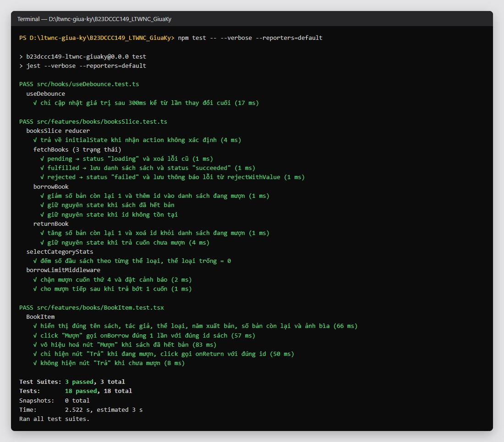

| File test | Nội dung |
|---|---|
| `src/features/books/booksSlice.test.ts` | reducer: 9 test (initialState, 3 trạng thái `fetchBooks`, mượn, trả), selector: 1, middleware: 2 |
| `src/features/books/BookItem.test.tsx` | React Testing Library + userEvent: 5 test (hiển thị thông tin, click "Mượn" đúng id, disabled khi hết bản, nút "Trả") |
| `src/hooks/useDebounce.test.ts` | fake timers: 1 test |

| Yêu cầu test của đề | Tối thiểu | Đã viết |
|---|---|---|
| Reducer của `booksSlice` | 4 | 9 (+ 1 selector, 2 middleware) |
| Component hiển thị sách (RTL + userEvent) | 3 | 5 |
| `useDebounce` dùng fake timers | 1 | 1 |
